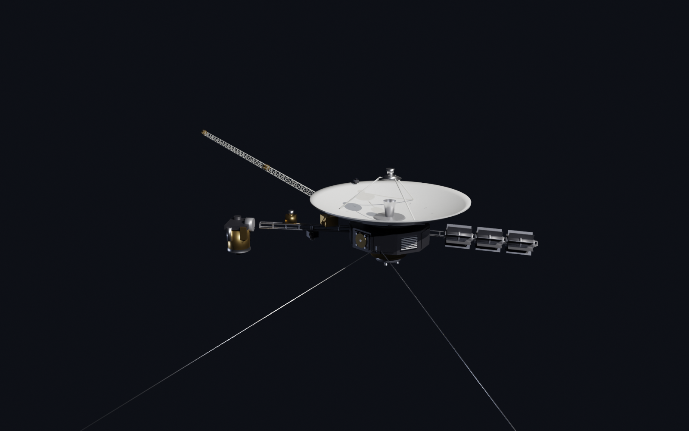

# 旅行者一号 · 三维轨迹

用 Blender 程序化建模旅行者一号，在网页里沿 NASA/JPL 真实轨道拖拽时间、查看实时位置，并预测未来位置。



## 运行网页

```powershell
python -m http.server 8458 --directory web
```

然后打开 <http://localhost:8458>（three.js 从 jsDelivr CDN 加载，需要联网）。

- **拖拽轨迹**：在三维视图里按住蓝色轨迹或探测器拖动，时间会跟着走到对应位置；底部时间轴也能拖。键盘 ←/→ 步进 1 天（Shift 30 天，Alt 1 小时），空格播放/暂停。
- **实时位置**：默认就是当前真实位置，每帧刷新：距太阳与距地球距离、单程光行时、日心速度、相对地球的远离速度、赤经赤纬和所处区域（日球层内、日鞘、星际空间）。
- **预测**：今天之后到 2100 年用 JPL 的弹道预测，2100–2200 年从 JPL 最后一个状态矢量做二体外推。“预测”页签列出由星历算出的事件（如首次距地球 1 光日、200 AU、2 光日），以及更远的外推（奥尔特云、1 光年、Gliese 445）。
- **飞掠**：点击“飞掠木星 / 飞掠土星”镜头会飞到行星附近。最近距离由星历算出：木星约 348,100 km，土星约 183,500 km。
- **模型小窗**：右侧是 Blender 导出的 GLB，鼠标悬停在部件上会显示它的用途。

## 重新生成

```powershell
python tools/fetch_ephemeris.py
```
从 JPL Horizons API 拉取星历，写入 `web/data/voyager1.json`。

```powershell
D:\Blender\blender.exe -b --factory-startup -P blender/build_voyager1.py
```
重新建模，输出 `web/models/voyager1.glb`、`blender/voyager1.blend` 和预览图。加 `-- --no-render` 跳过渲染。

`voyager1.blend` 里有两个场景：

- **Voyager1**：探测器模型。尺寸按真实值：高增益天线 3.66 m，磁强计杆 13 m，天线 2×10 m。
- **Trajectory**：真实轨迹，1 AU = 1 Blender 单位，1 帧 = 30 天。拖动 Blender 时间轴，探测器就会沿轨道移动。要让左上角的日期和距离文字跟着更新，打开文件时需要允许运行 Python 脚本。

## 数据来源

- 旅行者一号：NASA/JPL Horizons，目标 `-31`，日心黄道 J2000，1977-09-06 至 2099-12-31，飞掠期间按小时采样。
- 行星：JPL “Approximate Positions of the Planets” 开普勒根数；木星、土星在飞掠期间改用 Horizons 精确星历。
